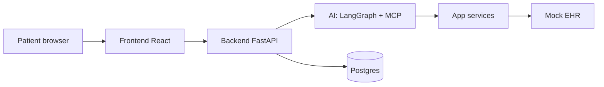

# MediConnect — AI-Native Multi-Hospital Scheduling Platform

One coherent healthcare SaaS:

**Patient request → AI understanding → real availability → authorized action → EHR integration → external verification → sync → questionnaire → workflow → doctor/admin visibility**

plus a visible **timeout → probe → sync-without-duplicate** recovery demo.

The priority is depth of one complete reliable workflow over breadth of disconnected features.

## Features

- **Patient:** register/login, AI chat + voice assistant, hospital/doctor discovery, real slot picker, book / reschedule / cancel, upcoming + history, questionnaires, preferences, profile, reviews.
- **Doctor:** today / upcoming / all appointments, calendar, availability + blocked time management, appointment detail with pre-visit answers, activity.
- **Hospital admin:** overview, profile, departments, specialties, doctors, schedules, appointments, questionnaires + builder, integrations, workflows, notifications, reviews, analytics, activity, audit.
- **Platform admin:** dashboard, hospital applications (approve / reject / corrections / suspend / reactivate), hospitals, doctors, patients, appointments, AI activity, integration activity, workflow monitoring, analytics, AI evaluation, ops health, audit logs.
- **AI core:** intent detection, context retrieval, clarification, hospital/doctor discovery, availability, booking, verification, sync, questionnaire, workflow trigger, human escalation. Administrative only — no diagnosis.
- **Reliability:** verify-before-confirm, idempotency keys, correlation IDs, unknown-outcome probe, reconciliation records, no blind retries, no double booking.

## Architecture (summary)



- AI never touches the database or EHR directly — only via typed MCP capabilities.
- Slots only come from the scheduling engine (working hours, blocks, leave, conflicts).
- No `confirmed` before external read-back verification.
- Tenant isolation enforced server-side per role.
- Full version with simple graphs: [`docs/ARCHITECTURE.md`](docs/ARCHITECTURE.md).

## Tech stack

| Layer | Choice |
|---|---|
| Frontend | React 18, Vite 6, Tailwind 3, react-router 6, recharts, react-markdown |
| Backend | FastAPI, SQLAlchemy 2, PostgreSQL 16, APScheduler, httpx |
| AI | LangChain + LangGraph + MCP registry, Mercury 2.5 primary, gpt-oss-120b fallback |
| Voice v1 | Groq whisper-large-v3-turbo STT, browser speechSynthesis TTS, no telephone |
| Mock EHR | Separate FastAPI service behind connector, replaceable |
| Infra | Docker + Docker Compose, nginx proxy, persistent volume |

How AI was built and which models are used (simple words): [`docs/AI_USAGE.md`](docs/AI_USAGE.md).
All 200 phase-wise prompts: [`docs/PROMPTS.md`](docs/PROMPTS.md).

## Requirements (host) — Docker-only

| Requirement | Version | Why |
|---|---|---|
| Docker Engine | 24+ | Runs every service in containers |
| Docker Compose | v2 (`docker compose version`) | Orchestrates the stack |
| Free RAM / disk | 4 GB RAM, ~3 GB disk | Images + postgres volume |
| Free ports | 8080, 8002, 8001, 5434 | Frontend, backend, mock-EHR, postgres (override via `FRONTEND_PORT` / `BACKEND_PORT` / `POSTGRES_PORT`) |

No Python, Node, or PostgreSQL needed on the host.

## Images

| Image | Source | Used by |
|---|---|---|
| `postgres:16-alpine` | Docker Hub (pulled) | `postgres` service — business database |
| `python:3.12-slim` | Docker Hub (pulled) | Base for `careaccess-backend` and `careaccess-mock-ehr` |
| `node:20-alpine` | Docker Hub (pulled) | Build stage of `careaccess-frontend` |
| `nginx:alpine` | Docker Hub (pulled) | Runtime stage of `careaccess-frontend` |
| `careaccess-backend:local` | Built from `backend/Dockerfile` | FastAPI + LangGraph + MCP |
| `careaccess-mock-ehr:local` | Built from `mock-ehr/Dockerfile` | Fake external health system |
| `careaccess-frontend:local` | Built from `frontend/Dockerfile` | React SPA via nginx |

Full reference: [`docs/DOCKER.md`](docs/DOCKER.md).

## Quickstart

```bash
cp .env.example .env        # add INCEPTION_API_KEY + GROQ_API_KEY to enable full AI + voice
docker compose up --build
```

| Service | URL |
|---|---|
| Frontend | http://localhost:8080 |
| Backend API + docs | http://localhost:8002/docs |
| Mock EHR | http://localhost:8001/health |


DB persists in `pgdata` volume. Backend auto-creates tables and seeds on first boot (`SEED_ON_STARTUP=true`).

```bash
docker compose up --build -d
docker compose ps
docker compose logs -f backend
docker compose down        # keep data
docker compose down -v     # fresh seed next boot
docker compose run --rm backend pytest -q
```

Production overlay (no seed, no dev ports):

```bash
docker compose -f docker-compose.yml -f docker-compose.prod.yml up --build -d
```

## Environment variables

See `.env.example` — never commit `.env`.

| Key | Purpose | Default |
|---|---|---|
| `DATABASE_URL`, `POSTGRES_*` | Postgres connection | `care/carepass/careplatform` |
| `JWT_SECRET`, `JWT_ALGORITHM`, `JWT_EXPIRE_MINUTES` | Auth tokens | change-me secret, HS256, 1440 |
| `MOCK_EHR_URL`, `MOCK_EHR_API_KEY` | EHR connector | `http://mock-ehr:8001`, dev key |
| `BACKEND_CORS_ORIGINS` | Allowed frontends | localhost ports |
| `SEED_ON_STARTUP` | Demo seed on boot | `true` |
| `INCEPTION_API_KEY`, `INCEPTION_MODEL` | Primary brain Mercury | `mercury-2.5`, key empty |
| `GROQ_API_KEY`, `GROQ_MODEL` | Fallback brain + STT | `openai/gpt-oss-120b`, key empty |
| `LLM_TIMEOUT_S`, `LLM_MAX_HOPS`, `AI_SHORT_WINDOW` | AI limits | 45, 5, 5 |
| `STT_PROVIDER`, `STT_MODEL`, `STT_LANGUAGE` | Voice hearing | groq-whisper, whisper-large-v3-turbo, en |
| `TTS_PROVIDER` | Voice speaking | browser |

Without keys the AI chat returns a safe `503 ai_unavailable` instead of guessing, and STT is disabled.

## AI setup

1. Put `INCEPTION_API_KEY` in `.env` for the primary thinker (Mercury 2.5).
2. Put `GROQ_API_KEY` in `.env` for fallback thinking + voice-to-text.
3. Restart backend. Chat shows which brain answered each turn.
4. Check brain status via `GET /api/v1/ai/voice-config` and login-gated AI routes.

Fail-closed: if both brains are down, no reply is fabricated.

## Voice setup (v1)

- Tap the orb in AI Assistant → browser records → `POST /ai/stt` (Groq whisper) → text → normal AI chat graph → spoken reply via browser voice + cards on screen.
- Mute toggle stops auto-speak. New tap/send interrupts current speech (barge-in). Silence auto-stops after ~2s, 60s max.
- Free-tier Groq voice limits apply; on 429 the orb says rate-limited, wait and retry.
- No telephone in v1. Server TTS is documented as v2, not built.
- Full notes: [`docs/VOICE.md`](docs/VOICE.md).

## Mock EHR

Separate service, swappable via connector. Supports patient/provider lookup, appointment create / retrieve / update / cancel, idempotent replay by idempotency key, 409 on provider+start conflict, `?fail=timeout` injection for the recovery demo. Data is in-memory demo store.

Booking rule: internal row is `pending` while the EHR write is in flight, `confirmed` only after read-back verification matches. Unknown outcomes are probed by idempotency key — never blindly retried, never duplicated.

## Workflows / questionnaires / notifications

- Booking fires `appointment.booked` → auto-assign questionnaire + patient/doctor notifications.
- Questionnaire assigned → patient answers conversationally → structured response → doctor reviews → completion workflow.
- Events, retries, idempotency, execution history, failure states, and human escalation via reconciliation records are all tracked and visible on dashboards.

## Tests

Run inside the container (no host pytest):

```bash
docker compose run --rm backend pytest -q
```

Covers: availability calculation, slot validation, state transitions, booking verify-sync, double/overlap rejection, unknown-outcome recovery, AI graph routing, prompt safety, typo repair, voice config.

## Demo accounts (System Admin password `12345`, others `password123`)

| Role | Email |
|---|---|
| System Admin | admin@gmail.com |
| Hospital admin | admin@citycare-general.org |
| Doctor | doc0@example.org |
| Patient | aarav@example.org |

## 5-minute demo script

1. **Login as patient** → AI Assistant → send *"I need to see a doctor for my shoulder pain sometime this week."* → intent trace + real doctor/slot options → **Book** → verified confirmation with correlation ID.
2. **Voice**: same page → tap orb → speak → spoken verified reply.
3. **Appointment**: Upcoming → details → verification badge + history timeline → questionnaire → fill conversationally.
4. **Doctor** (`doc0`): dashboard → today → open visit → pre-visit answers.
5. **Hospital admin**: overview → integrations → AI activity → questionnaires.
6. **Failure demo**: Platform admin → Reconciliation → *Probe EHR + sync* on seeded `unknown_outcome` record; or book via API with `"simulate":"timeout_after_create"` and watch probe → sync, no duplicate. See `docs/DEMO.md`.
7. **Platform admin**: Applications → approve `northgate-community` → ops wall, audit, analytics.

## Key rules enforced

- AI never touches Postgres/EHR directly — only via typed MCP capabilities.
- Slots only from the scheduling engine.
- No confirmed before external verification; unknown outcomes probed by idempotency key.
- Tenant isolation server-side.
- AI is administrative: diagnosis/prescription requests get safe refusal + escalation offer.

## Known limitations

- Voice is browser orb + Groq STT + browser TTS only. No telephone, no streaming, no server TTS.
- Mock EHR has no facility/calendar/availability lookup and loses data on restart.
- Notifications are database records only (no SMS/email provider).
- Workflows run inline, not async with delays.
- Seed uses demo Unsplash photos and fixed demo accounts.
- No public deploy, TLS, backups, or monitoring beyond container healthchecks.

## Future improvements

- Hosted server TTS with browser fallback, telephone/SIP channel reusing the same graph.
- Real vendor EHR connector with facility/calendar sync and persistent mapping.
- Async workflow runner with delays, retries, schedules.
- SMS/email/push delivery for notifications and reminders.
- Prod secrets manager, TLS, backups, metrics dashboards.
- More evaluation sets for prompts and safety.

## Docs

- `docs/ARCHITECTURE.md` — layers, flows, booking/verify/recovery, tenant model
- `docs/PROMPTS.md` — 200 phase-wise prompts from system admin to voice
- `docs/AI_USAGE.md` — how AI helped build this, which models run inside, in simple words
- `docs/DOCKER.md` — host requirements, images, services/ports, commands
- `docs/VOICE.md` — voice flow, config, limits, prod fixes
- `docs/DEMO.md` — click-by-click demo + failure scenario
- `.env.example` — all config; never commit `.env`
