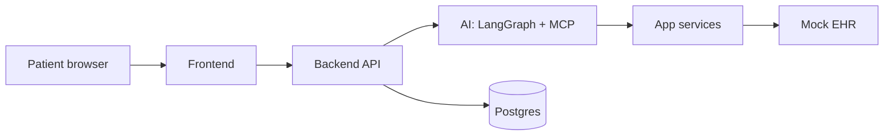
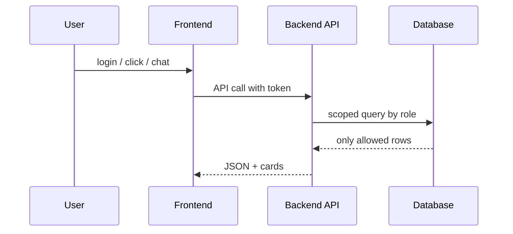
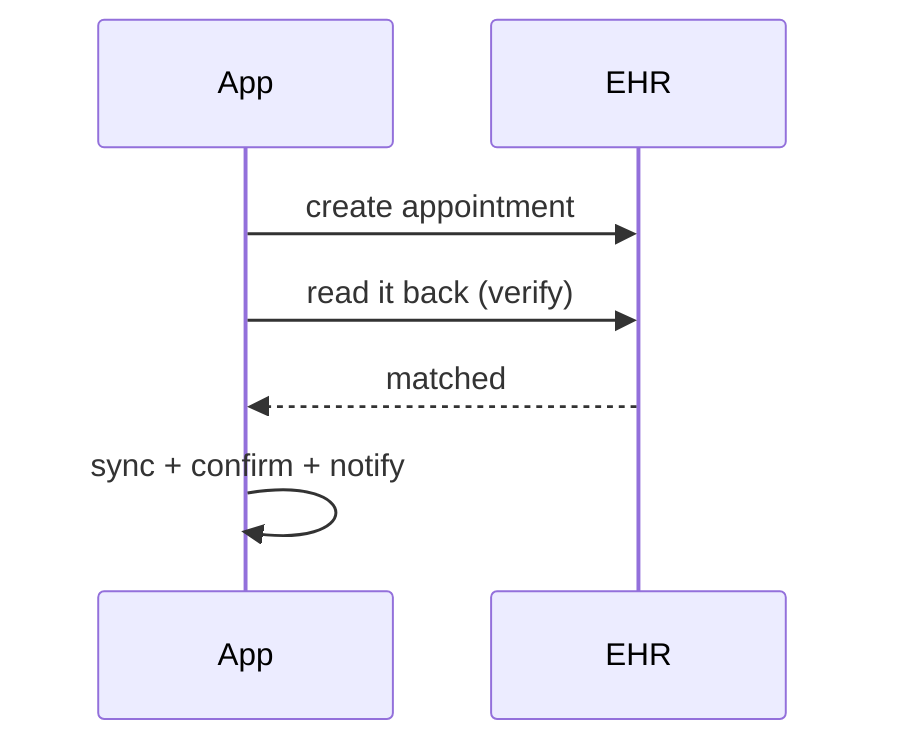
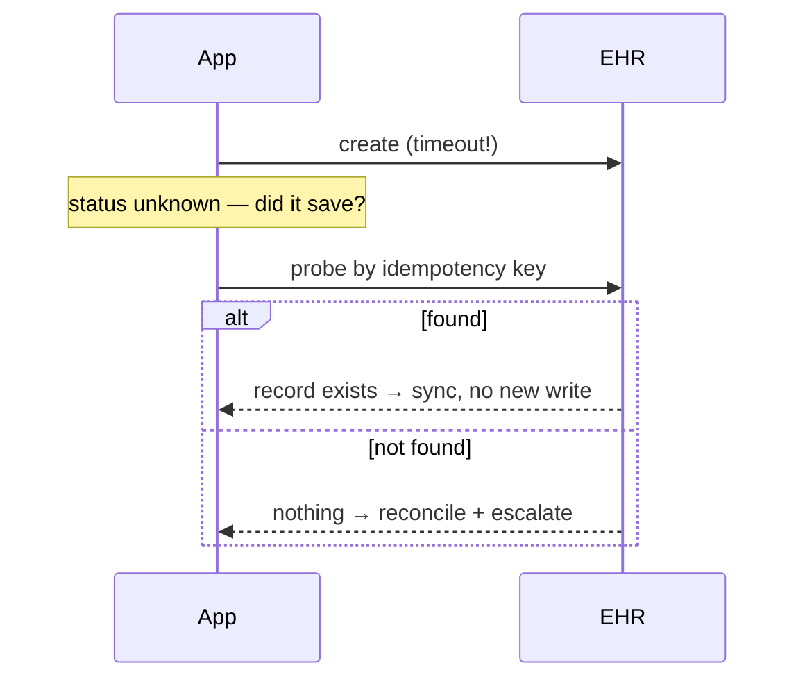
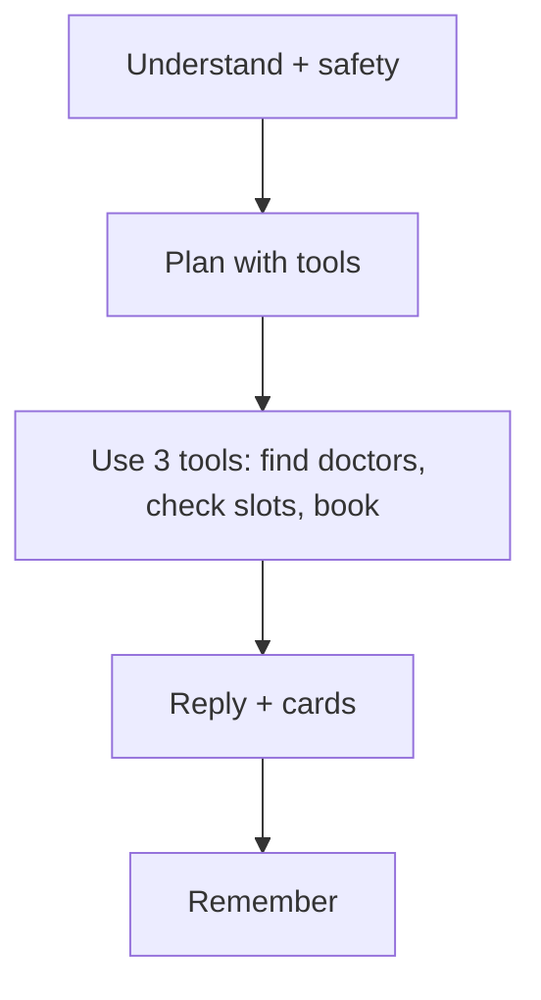
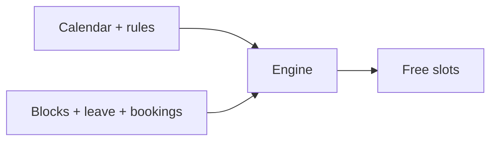
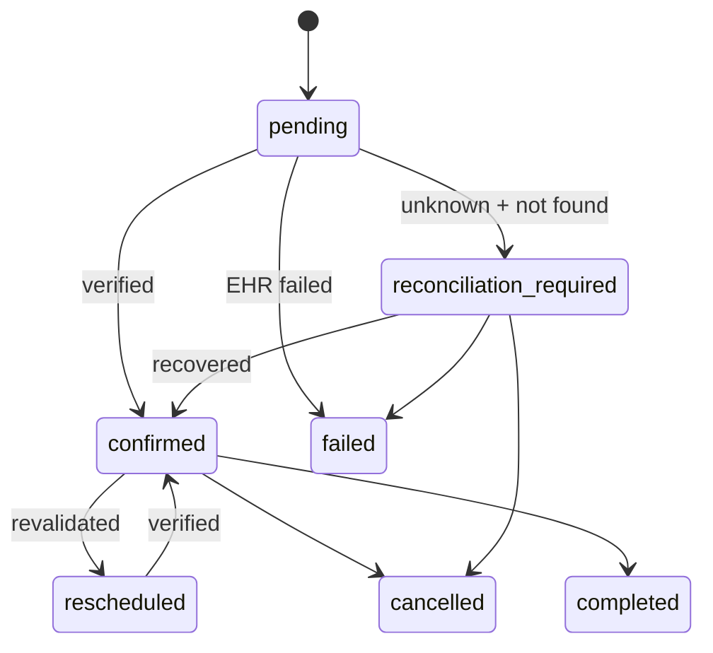
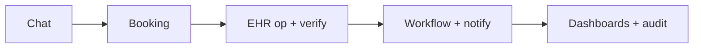
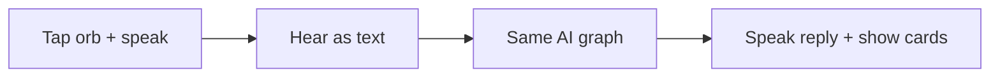
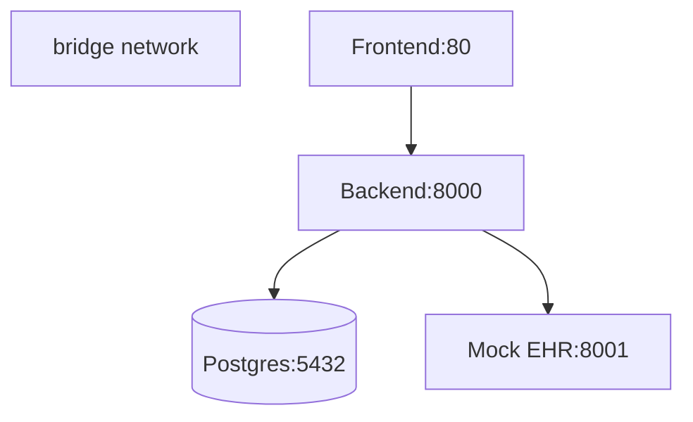

# Architecture — MediConnect

One complete reliable workflow, not a collection of demos:

**Patient request → AI understanding → real availability → authorized action → EHR integration → external verification → sync → questionnaire → workflow → doctor/admin visibility**

plus **timeout → probe → sync-without-duplicate** recovery.

> Graphs below are intentionally simple (3–6 boxes). Full detail lives in theory text under each graph.

## 1. Layers

**Theory:**
- Frontend is a React single-page app served by nginx. It calls one backend API. No direct database or EHR access from the browser.
- Backend is FastAPI. It owns auth, hospitals, doctors, scheduling, appointments, questionnaires, workflows, notifications, dashboards, AI chat, and the capability catalog.
- App services hold the real business logic: slot engine, booking with verify-then-confirm, questionnaire auto-assign, workflow firing, notifications, audit.
- AI layer sits beside services, not above them. It reasons, then calls the same services through controlled capabilities. It never writes to tables or calls the EHR directly.
- Integration layer is one connector client pointing at the Mock EHR container. Swapping to a real vendor means swapping that client, nothing in AI or scheduling changes.
- Postgres is authoritative for all business state. The Mock EHR keeps its own demo store.

## 2. Request flow (who can see what)

**Theory:**
- Four roles: platform admin (sees everything, approves hospitals), hospital admin (locked to own hospital), doctor (locked to own appointments and availability), patient (only own appointments, questionnaires, chats).
- Every request carries a login token. The backend checks role and tenant before any query. A hospital admin asking for another hospital's data gets rejected server-side, not just hidden in UI.
- Patients see upcoming vs history lists. Doctors see today / upcoming. Admins see cross-cutting ops walls, audit, and analytics.

## 3. Booking: verify before confirm

**Theory:**
- Steps in order: check idempotency key (same key returns same row, never a second row) → load doctor (must be active), hospital (must be approved), calendar (must be active) → validate slot with the scheduling engine (working hours, blocks, leave, conflicts, past check) → insert row as `pending` (a millisecond transit state, not an approval inbox) → write integration operation as `started` → create in EHR → mark operation success → write verification as `pending` → read the external record back → if IDs match, mark verification `matched`, store external ID + mapping, transition to `confirmed`, write history + audit + ops events, notify patient and doctor, fire `appointment.booked` workflow, auto-assign a questionnaire.
- The patient never gets a final confirmation until that read-back matches. A successful write response alone is not enough.
- Example tools used here (only 3 shown in graph spirit): `check_availability`, `create_appointment`, `verify_external_appointment`. The rest (reschedule, cancel, sync, notifications) follow the same verify pattern and are listed in the capability table below.

## 4. Failure recovery: unknown outcome, no duplicates

**Theory:**
- Triggers: timeout, network failure, verify returns not-found or error, auth/rate/outage/validation/mapping errors, slot conflict, duplicate request, partial success.
- Rule: never blindly retry a create that may already exist. First probe the EHR by idempotency key. Found → sync safely (store external ID, verification `probe_by_idempotency=matched`, transition to `confirmed`, fire recovered event). Not found → open a reconciliation record, set integration to `reconciliation_required`, fire escalation, show it on the ops dashboard for a human.
- External 409 conflict maps to a coded `SLOT_TAKEN` response with 3 alternative slots, not a stored row. The loser of a race keeps zero rows.
- Demo: book with `simulate=timeout_after_create` (actually creates in EHR, then pretends timeout) → returns `recovered:true, verified:true`, no duplicate. Or use the seeded reconciliation row → *Probe EHR + sync*.

## 5. AI: LangGraph + MCP (simple view)

**Theory — full flow in words:**
- Full chain: conversation (load/create chat, save user turn, short window of history) → context (load 5 durable slices: conversational, transactional, user prefs, workflow state, integration state) → classify intent (book, reschedule, cancel, lookup, questionnaire, greeting, unsupported, unrelated, ambiguous; repairs typos like shoulder spelling) → safety check (allow, deny clinical, escalate urgent/human request) → scope (unrelated/unsupported short-circuit) → clarification (ask only for truly missing fields: specialty-or-doctor + date for booking) → tool router (direct 1 tool, compose 2–4 tools wiring outputs forward, or unavailable with alternatives) → tool result (validated call, hop counter, chain continuation) → human transfer when needed (logged tracked request with reference number, never a live agent) → response (grounded in verified tool output, one-line when a card renders, typo `Did you mean…?`) → memory (decide if important, rewrite short summary, extract durable entities).
- Example 3–4 tools in graph: `search_doctors`, `check_availability`, `create_appointment`. Everything else (search hospitals, reschedule, cancel, questionnaires, notifications, verify, sync, transfer) is chosen by the same planner and documented in the table below, not drawn.
- Fail-closed: if both brains are down, the API returns `503 ai_unavailable`. Nothing is fabricated.

## 6. Capabilities (what AI is allowed to do)

AI calls only these typed, authorized, audited actions. Every call records status, latency, and correlation ID.

| Group | Capabilities |
|---|---|
| Find | search hospitals, search doctors, doctor/hospital details, reviews |
| Slots | check real availability (engine only, never invented) |
| Book | create / reschedule / cancel appointment (all verify + sync) |
| My data | my appointments, my questionnaires, my notifications, my context, update prefs |
| Ask | get questionnaire, submit answers, send notification, start workflow |
| Check | verify external record, synchronize state by idempotency key |
| Help | transfer to human (tracked request, no live agent) |

**Theory:** reads run first, writes delegate to the same app services a human click uses. Required args and ID types are validated before any call. Writes are idempotent where it matters.

## 7. Scheduling truth + concurrency

**Theory:**
- A slot is free only when: doctor active, calendar active, inside working hours, not blocked, doctor not on leave, not already booked, type compatible, not in the past.
- No locks. Two users racing for one slot are arbitrated atomically at commit time by a unique index (doctor + start) plus an overlap guard for ranges. One wins, the other rolls back and gets `409 SLOT_TAKEN` + 3 free alternatives for one-tap rebook. Same idempotency key always returns the same row. Past starts get `SLOT_PAST`.
- Availability is revalidated immediately before booking, so list-then-book races become clean rejections, not double bookings.

## 8. Appointment states

**Theory:** `pending` is transit. `confirmed` means verified. Terminal states are completed, no-show, cancelled, failed. There is no stored `rejected` row — rejection is a coded response. Every transition writes history.

## 9. Data model (groups, not a giant diagram)

- **Identity:** users (role + hospital/doctor/patient links), hospitals (lifecycle draft → submitted → under review → approved/rejected, plus suspend/reactivate), departments, specialties, doctors (invited → active → inactive), patients, preferences.
- **Scheduling:** calendars, availability rules, blocked slots, leave, appointment types, appointments (unique doctor+start, idempotency key, external ID, correlation ID, integration status), appointment history.
- **Integration:** healthcare connections, external ID maps (internal ↔ external), integration operations, integration verifications, reconciliation records.
- **AI:** conversations, messages (card payloads), contexts (5 slices, never one blob), capability definitions + executions, evaluations.
- **Ops:** questionnaires + responses, workflows + executions, notifications, reviews, audit events, operational events.
- All joined for tracing by `correlation_id`.

## 10. Observability: one ID across everything

**Theory:** each turn/booking mints a short correlation ID carried through appointment, operations, verifications, reconciliation, workflow runs, capability executions, audit and ops events. Admin screens join on it to show conversation → decision → capability → scheduling → EHR → verify → sync → workflow → notification as one timeline. Logs carry bytes/counts, never raw health content.

## 11. Voice v1

**Theory:** browser records audio → Groq whisper-large-v3-turbo turns it into text → the exact same LangGraph + capabilities run (booking/verify logic unchanged) → browser voice speaks the reply while cards stay on screen. Mute toggle, barge-in (new tap cancels speech), 2s silence auto-stop, 60s max, rate-limit message on 429. No telephone in v1. Server TTS is a documented v2 swap, not built.

## 12. Docker topology

**Theory:**
- Host needs only Docker. Services: postgres (persistent volume, host 5434), mock-ehr (host 8001, API-key guarded, in-memory demo store), backend (host 8002, waits for both healthy, auto-creates tables + seeds), frontend nginx (host 8080, proxies API/docs/health to backend).
- Secrets come from `.env`, never baked into images. Prod overlay disables seeds and internalizes DB/EHR ports. Tests run inside the backend container. Full commands in `DOCKER.md`.
